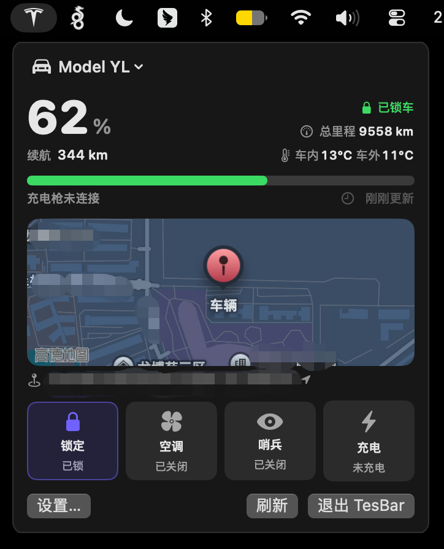

# TesBar

macOS 菜单栏应用：查看 Tesla 车辆状态、发送控制指令。原生 SwiftUI `MenuBarExtra`（无 Dock 图标，`LSUIElement`），数据走 Fleet API 轮询、指令走 VCP（Vehicle Command Protocol）签名直发。单账号多车，菜单内切换。



## 环境要求

- macOS 13+
- Swift 6.0 工具链（Xcode Command Line Tools 即可，无需完整 Xcode）

## 构建

凭据/私钥打包时注入（ADR-0005），仓库不含真值 `BuildConfig.swift`：

```bash
./Scripts/build-app.sh \
  --client-id xxx \
  --client-secret xxx \
  --private-key path/to/private.pem
```

参数（`--help` 看全部）：

- `--client-id` / `--client-secret`：[developer.tesla.cn](https://developer.tesla.cn) 应用的 OAuth client 凭据。
- `--private-key`：共享 VCP 私钥 PEM **文件路径**。省略时打包后菜单会提示“此构建缺少内置凭据”。
- `--pairing-domain`：公钥托管域名，默认 `public.stanzhai.site`。

也支持同名环境变量（参数优先）：`TESBAR_CLIENT_ID` / `TESBAR_CLIENT_SECRET` / `TESBAR_VCP_PRIVATE_KEY_PEM`（PEM 文本）/ `TESBAR_PAIRING_DOMAIN`。

脚本会比对内置私钥推导公钥与线上 `.well-known` 托管公钥，不一致打警告。产出 `build/TesBar.app`（`LSUIElement=true`、本地固定身份签名），`open build/TesBar.app` 运行。

### CLT 特殊编译参数

CommandLineTools 环境缺少 `libSwiftUIMacros.dylib`（SwiftUI 宏插件运行时，随完整 Xcode 分发），`swift build` / `swift test` 需额外传 `external-plugin-path` 指向该 dylib 副本及插件服务器。`build-app.sh` 已内置；单独跑 `swift test` 见[测试](#测试)。

## 密钥部署与三方一致（配对报错先看这里）

三把公钥必须一致，配对才会过：**域名托管公钥** = **Tesla 注册公钥**（`POST /api/1/partner_accounts` 存的）= **app 内置私钥推导公钥**。任何一把不同步，Tesla App 扫码配对即报“无法授予第三方访问权限 / 此第三方未向Tesla注册”。

日常部署（[ADR-0005](docs/adr/0005-shared-embedded-vcp-key.md) 流程）：

1. `openssl ecparam -name prime256v1 -genkey -noout -out private.pem`（车辆仅支持 prime256v1）
2. `openssl ec -in private.pem -pubout -out public.pem`，把 `public.pem` 内容上传到 `https://<pairing-domain>/.well-known/appspecific/com.tesla.3p.public-key.pem`（`Content-Type` 无所谓，Tesla 拉原始字节）
3. `build-app.sh --private-key private.pem` 打包——脚本会自检内置私钥与线上托管公钥一致，不一致打警告

### 换钥后必须重新注册（2026-10-19 踩过的坑）

换密钥对后只更新托管 `.pem` **不够**：`partner_accounts` 里仍存旧公钥，配对照样报“未注册”。完整流程：

```bash
TOKEN=$(curl -sS -X POST 'https://auth.tesla.cn/oauth2/v3/token' \
  -H 'Content-Type: application/x-www-form-urlencoded' \
  --data-urlencode 'grant_type=client_credentials' \
  --data-urlencode 'client_id=<client-id>' \
  --data-urlencode 'client_secret=<client-secret>' \
  --data-urlencode 'scope=openid offline_access user_data vehicle_device_data vehicle_location vehicle_cmds vehicle_charging_cmds' \
  --data-urlencode 'audience=https://fleet-api.prd.cn.vn.cloud.tesla.cn' \
  | python3 -c 'import sys,json;print(json.load(sys.stdin)["access_token"])')

# 重新注册（Tesla 会拉当前托管公钥覆盖旧记录）
curl -X POST 'https://fleet-api.prd.cn.vn.cloud.tesla.cn/api/1/partner_accounts' \
  -H "Authorization: Bearer $TOKEN" -H 'Content-Type: application/json' \
  -d '{"domain":"<pairing-domain>"}'

# 验证：此处返回的 public_key 应等于域名托管的公钥
curl -H "Authorization: Bearer $TOKEN" \
  'https://fleet-api.prd.cn.vn.cloud.tesla.cn/api/1/partner_accounts/public_key?domain=<pairing-domain>'
```

重注册不影响已配对车辆，但已用旧钥配对的车会拒绝新钥签名——需在车机“锁屏”删旧钥匙、重新走 `tesla.cn/_ak/<domain>` 配对。

### 其他“未注册”排查

App 的 412 自动重注册只在拉车/发指令时触发，配对页在它之前——换钥场景必须手工跑上面的 curl。若三方公钥已一致仍报错：

- 重开 Tesla App 清配对页缓存再扫
- 手机别在与托管服务器同内网时配对（DDNS 场景已知坑）
- developer.tesla.cn 应用 allowed_origins 须含 `<pairing-domain>`

## 首次设置（两步向导）

1. **登录**：OAuth 授权一次（auth.tesla.cn，中国区账号），token 存 Keychain 自动刷新。
2. **配对**：打开 `https://tesla.cn/_ak/<pairing-domain>`，在车上（或 Tesla App）完成 Virtual Key 注册，点“验证”拉车辆列表确认。

凭据与密钥已内置，用户无需粘贴任何 client_id/公钥。退出登录（设置 → 账户）只删 token 与车辆数据，配对保留，重登即恢复。

### 仅中国区

硬编码 `auth.tesla.cn` / `fleet-api.prd.cn.vn.cloud.tesla.cn`，不支持海外区账号（RegionResolver 固定 CN 域）。海外账号需自行改源码。

## 登录自启

设置 → “登录时启动”。注册走 `SMAppService`（macOS 13+ 官方 API，无需额外 LaunchAgent）。开关即时生效；移动或重命名 `.app` 需重新打开一次开关。

## 限制

- **单账号**：只支持一套 Tesla 凭据 + 一把共享 VCP 私钥（ADR-0005），多账号明确不做（多车在同账号内切换）。
- 无 Dock 图标：设计如此（菜单栏常驻）。

## 测试

```bash
swift test --jobs 1 \
  -Xswiftc -Xfrontend -Xswiftc -external-plugin-path \
  -Xswiftc -Xfrontend -Xswiftc "/tmp/tesbar-plugins#/Library/Developer/CommandLineTools/usr/bin/swift-plugin-server"

`BuildConfig.swift` 在 gitignore 里：fresh clone 后先跑一次 `./Scripts/build-app.sh`（不带环境变量也行，生成空值兜底），或手工放置同形状文件，再 `swift test`。

偶发 TestingMacros 插件竞态（`external macro implementation type ... not found`）：等几秒重跑即可。
